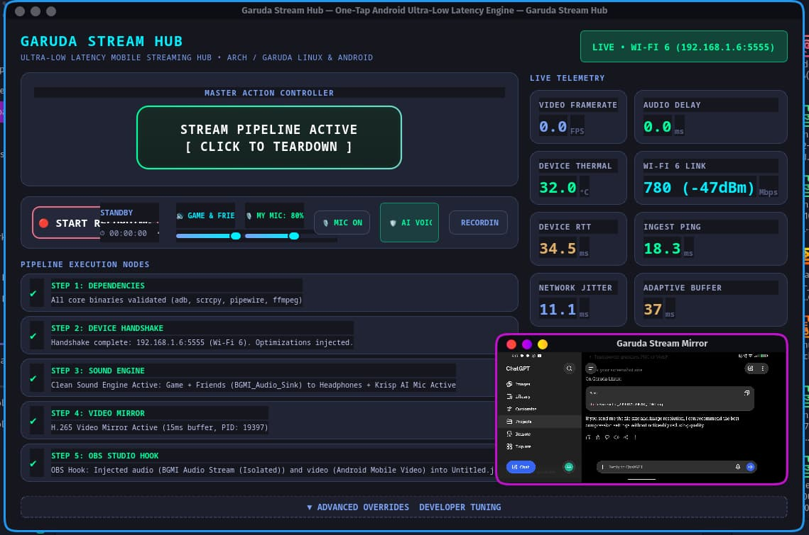

# Garuda Stream Hub 🎮⚡

<p align="center">
  
</p>

<p align="center">
  <a href="https://github.com/aswin18antony-code/Garuda-Stream-Hub/actions"></a>
  <a href="#"></a>
  <a href="#"></a>
  <a href="#"></a>
  <a href="#"></a>
  <a href="LICENSE"></a>
</p>

---

## 📌 Overview

**Garuda Stream Hub** is a studio-grade, one-tap ultra-low latency streaming utility engineered for competitive mobile gaming capture and multi-track recording on **Garuda / Arch Linux** and **Windows**.

It orchestrates high-performance native **C++ subroutines (pybind11)**, an asynchronous multi-threaded **PyQt6 GUI**, **PipeWire / PulseAudio** digital audio isolation, **Qualcomm hardware H.265 (HEVC)** video mirroring, neural **AI noise suppression (RNNoise)**, and automated **OBS Studio scene injection** into a single master execution button.

---

## 🌟 Key Architecture & Highlights

```
                                 +-----------------------------------+
                                 |     ONE-TAP CONTROL DASHBOARD     |
                                 |  [ INITIALIZE STREAM PIPELINE ]   |
                                 +-----------------------------------+
                                                   |
                     +----------------------------+----------------------------+
                     v                                                         v
        [ ANDROID CORE ENGINE ]                                   [ AUDIO / VIDEO PIPELINE ]
  +---------------------------------+                       +---------------------------------------+
  | - Wireless Pairing Daemon       |                       | - PulseAudio/PipeWire Loopback Sync   |
  | - Audio Loopback Routing        |                       | - OBS Virtual Camera Injector         |
  | - Sysctl Performance Injection  |                       | - FFmpeg Hardware NVENC/VAAPI Encoder |
  | - AOT Gaming Speed Compiler     |                       | - AI RNNoise DSP Voice Isolation      |
  +---------------------------------+                       +---------------------------------------+
```

### 1. ⚡ One-Tap Automated Pipeline
- **Zero-Configuration Handshake**: Automatically detects connected devices via USB 3.2 or Wi-Fi 6 (5GHz TCP:5555 mode) and verifies ADB communication.
- **Kernel & Process Priority Elevation**: Automates process renicing (`nice -10`) for minimal frame jitter under CPU load.
- **Android Speed Optimization**: Executes Ahead-Of-Time (AOT) package compilation (`cmd package compile -m speed`) and toggles battery-saver overrides during streaming.

### 2. 🎙️ Advanced Audio Multiplexing ("The Mic Bug Fixer")
- **Isolated Virtual Sink**: Dynamically generates `BGMI_Audio_Sink` in PipeWire / PulseAudio.
- **Clean Audio Separation**:
  - In-game audio and teammate voice calls are routed into `BGMI_Audio_Sink`.
  - Zero-latency headphone loopback allows you to hear in-game footsteps and discord in real-time.
  - PC desktop audio (Discord, Spotify, browser) **never bleeds** into your stream or recordings.
  - OBS captures exclusively `BGMI_Audio_Sink.monitor`.

### 3. 🧠 Neural AI Voice Isolation & Air Clean
- Integrates **RNNoise** neural voice suppression with multi-band DSP bandpass filters:
  - High-pass filter (125 Hz) eliminates wind and heavy breathing blasts.
  - Low-pass filter (11.5 kHz) eliminates high-frequency fan hiss and room resonance.
  - Musical noise gate mutes ambient room sounds when the player is not speaking.

### 4. 🎬 Studio Multi-Track Recording Engine
- **1-Click Hardware Recording**: Direct recording triggers with real-time HUD counters.
- **Synchronized Multi-Track MP4 Output**:
  - **Track 1 (Master Mix - Default)**: Game + Teammates + Player Mic balanced in stereo.
  - **Track 2 (Game & Friends Isolated)**: Raw digital audio of game and voice call.
  - **Track 3 (My Mic Isolated)**: Pure voice microphone track for editing in Premiere Pro, DaVinci Resolve, or CapCut.

### 5. 🚀 Native C++ Telemetry Sentinel (`stream_native`)
- RFC 3550 jitter calculation and low-overhead socket ping engine.
- Direct `/proc` watcher for zero-overhead CPU and memory profiling.
- Pure Python fallback when running without C++ compiler on Windows.

---

## 📦 Releases & Downloads

Pre-built binaries and portable bundles are automatically built via GitHub Actions CI/CD:

| OS | Package | Format | Notes |
| :--- | :--- | :--- | :--- |
| **Linux (Arch / Garuda / Ubuntu)** | `garuda-stream-hub-linux-x86_64.tar.gz` | Standalone Binary | Ready to run, includes native engines |
| **Windows 10 / 11 (x64)** | `GarudaStreamHub-windows-x64.zip` | Standalone `.exe` | Portable, zero installation needed |

👉 **[Download the Latest Release](https://github.com/aswin18antony-code/Garuda-Stream-Hub/releases)**

---

## 🛠️ Quick Start Guide

### Prerequisites
- **Python**: 3.10 or higher
- **scrcpy**: 2.0+ (with ADB tools)
- **FFmpeg**: 5.0+
- **PipeWire / PulseAudio** (Linux) or **WASAPI** (Windows)

### Linux (Garuda / Arch / Ubuntu)

```bash
# Clone the repository
git clone https://github.com/aswin18antony-code/Garuda-Stream-Hub.git
cd Garuda-Stream-Hub

# Build native C++ pybind11 module
make

# Run the PyQt6 Desktop Application
./run.sh

# Or launch in headless CLI mode
./run.sh --cli
```

### Windows (PowerShell / Command Prompt)

```cmd
git clone https://github.com/aswin18antony-code/Garuda-Stream-Hub.git
cd Garuda-Stream-Hub

pip install -r requirements.txt
python src/main.py
```

---

## 🧪 Testing

Comprehensive test suite verifying Android discovery, PipeWire virtual audio sinks, DSP filters, native C++ extensions, and multi-track recording:

```bash
make test
```

---

## 🏗️ Project Architecture

```
Garuda-Stream-Hub/
├── assets/                  # Hero screenshots, graphics, and badges
│   └── screenshots/         # Dashboard UI captures
├── src/
│   ├── main.py              # Application entrypoint (CLI & GUI dispatcher)
│   ├── android/             # ADB discovery, auto-pairing, telemetry
│   ├── audio/               # PipeWire virtual sink, RNNoise DSP, voice isolation
│   ├── core/                # Pipeline orchestrator, configuration, system optimizer
│   ├── native/              # C++17 pybind11 low-overhead telemetry module
│   ├── obs/                 # Automated OBS Studio scene collection injector
│   ├── recorder/            # FFmpeg multi-track studio recording engine
│   ├── ui/                  # PyQt6 Tokyo Night / Dracula Neon responsive GUI
│   └── video/               # scrcpy controller & adaptive jitter buffer
├── tests/                   # Automated unit test suite
├── scripts/                 # Build and packaging automation (Linux & Windows)
├── .github/workflows/       # GitHub Actions CI/CD pipeline
├── Makefile                 # C++ build & test recipes
└── pyproject.toml           # PEP 517/621 packaging metadata
```

---

## 👨‍💻 Developer & Portfolio Highlights

This project demonstrates production-grade software engineering competencies:
- **Systems & Native Programming**: C++17 pybind11 integration, Linux `/proc` IPC, low-level socket pings.
- **Digital Signal Processing (DSP)**: PipeWire module-null-sink, LADSPA neural noise filter-chains, FFmpeg multi-track multiplexing.
- **Concurrent GUI Architecture**: Thread-safe PyQt6 signal bridges, non-blocking asynchronous orchestrators.
- **DevOps & CI/CD**: Multi-platform matrix builds on GitHub Actions (Ubuntu + Windows), automated binary packaging with PyInstaller.

---

## 📄 License

This project is licensed under the [MIT License](LICENSE).
